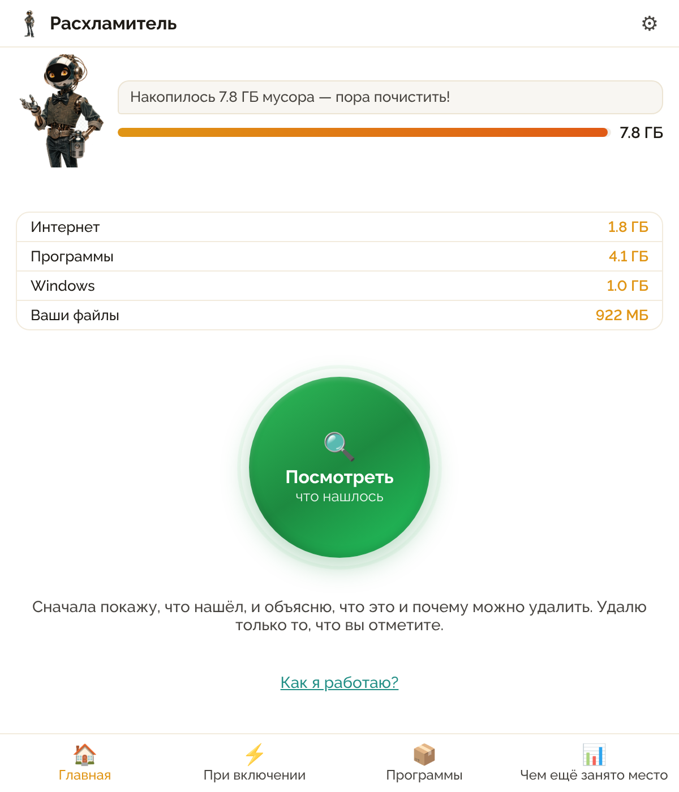
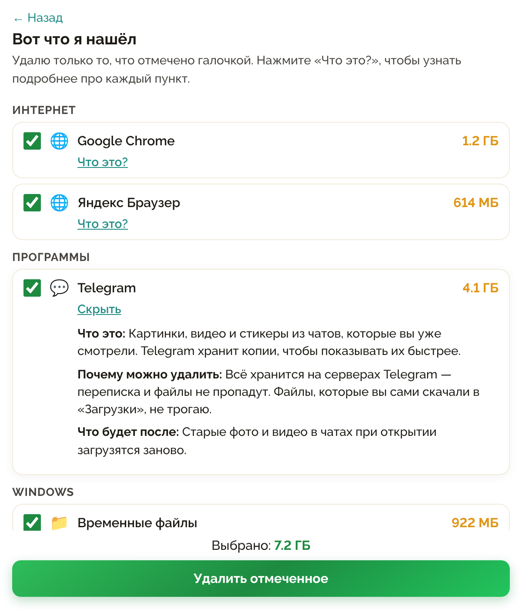
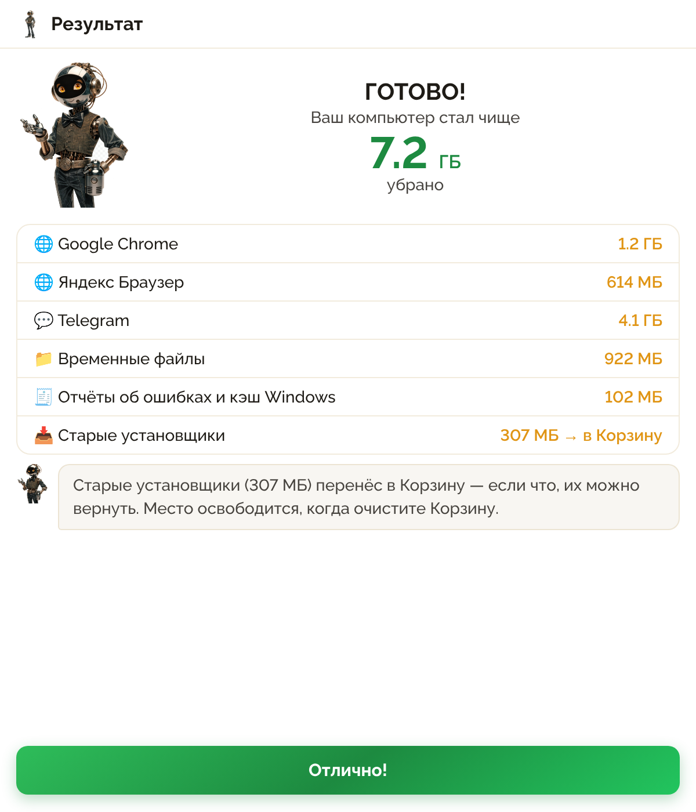
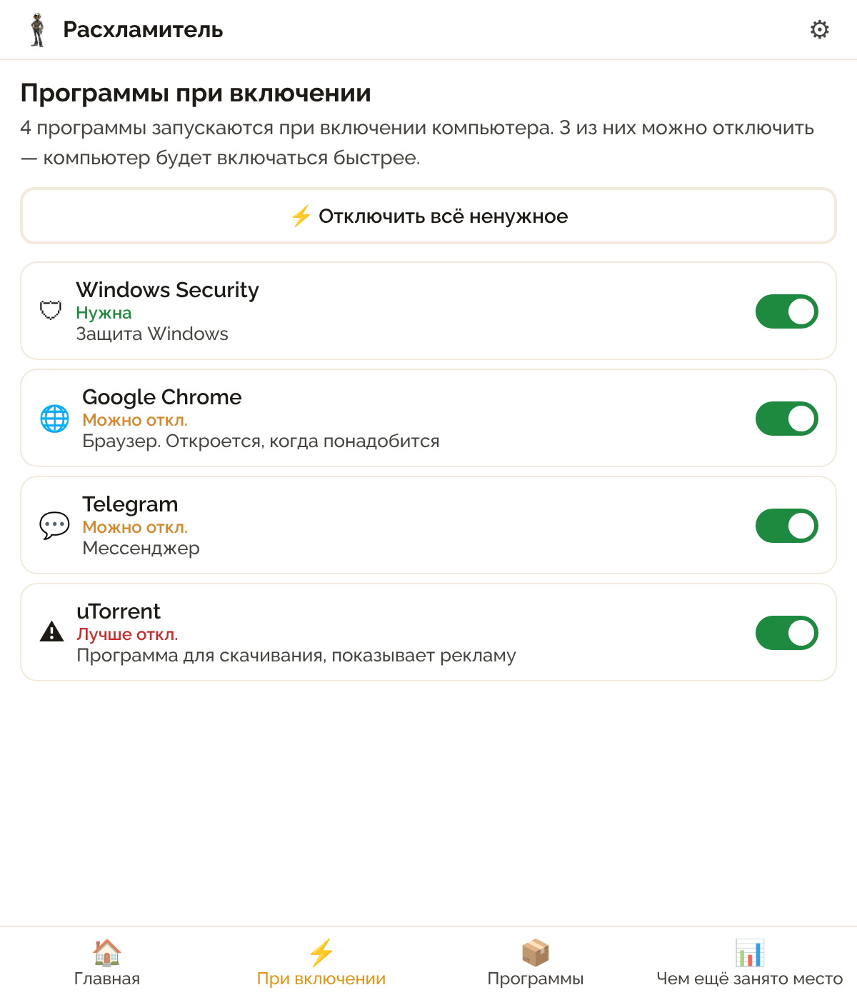
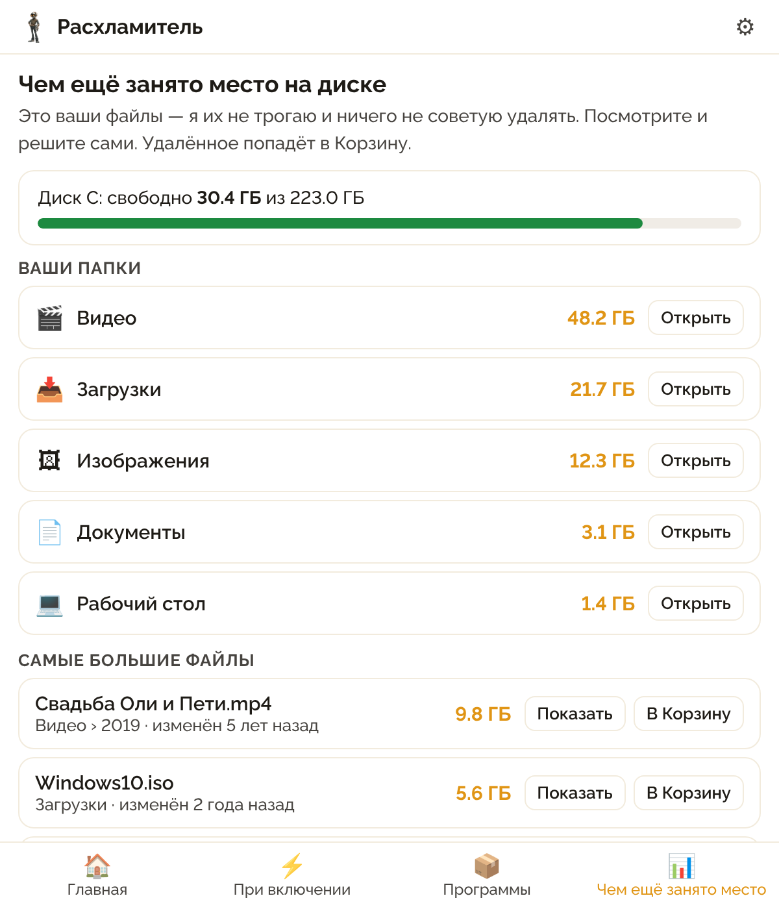

<p align="center"></p>

<h1 align="center">Расхламитель ПК</h1>

<p align="center">
Бесплатная программа для Windows 10 и 11, которая чистит компьютер от мусора.<br>
Одна кнопка, понятный язык, ничего важного не трогает.
</p>

<p align="center"><a href="https://github.com/Elenaevolvecode/rashlamitel_prog/releases/latest"><b>⬇ Скачать последнюю версию</b></a></p>

<p align="center">



</p>

## Для кого

Для тех, кто не хочет разбираться в настройках. Программа сначала показывает, что нашла, объясняет каждый пункт
простыми словами — *что это, почему можно удалить, что будет после* — и удаляет только то, что вы отметили.

## Что умеет

- **Почистить компьютер.** Кэш браузеров (Chrome, Яндекс, Edge, Opera, Firefox), Telegram, Discord, Steam,
  временные файлы Windows, отчёты об ошибках, старые установщики из «Загрузок» (в Корзину, их можно вернуть).
  Корзина — только если поставить галочку.
- **Глубокая очистка Windows.** Старые обновления и прошлая версия Windows (Windows.old) — через встроенную «Очистку диска».
- **Программы при включении.** Что запускается вместе с Windows — в том числе через Планировщик заданий —
  с пояснениями, что нужно, а что можно отключить. «Отключить всё ненужное» — одним разрешением Windows.
- **Чем ещё занято место.** Сколько весят ваши папки и какие файлы самые большие.
- **Напоминание.** Раз в месяц, если накопилось больше 1 ГБ мусора, — небольшое окошко в углу экрана. В фоне программа не висит.
- **Программы.** Список установленных, подсказки, какие обычно не нужны, и запуск их штатного удаления.

**Чего не трогает никогда:** ваши документы, фото и видео, пароли, закладки и входы на сайты.
Работает только на вашем компьютере, ничего не отправляет в интернет.

<p align="center">



</p>

## Установка

1. Откройте [страницу последней версии](https://github.com/Elenaevolvecode/rashlamitel_prog/releases/latest)
   и скачайте файл `Rashlamitel-Setup-….exe` из раздела **Assets**.
2. Запустите его. Если Windows покажет окно **«Windows защитил ваш компьютер»** — нажмите **«Подробнее»**,
   затем **«Выполнить в любом случае»**. Это предупреждение появляется у программ без платной цифровой подписи.
3. Программа установится и откроется сама, ярлык появится на рабочем столе.

Удаление: Параметры → Приложения → «Расхламитель ПК» → Удалить.

---

## Для разработчиков

Electron + Node.js. Работа с файлами — на Node, с системой Windows — через PowerShell
(скрипты передаются через `-EncodedCommand`, аргументы — отдельно, без подстановки в текст скрипта).
Интерфейс не получает путей и команд — только номера пунктов; всё опасное делает основной процесс.

```bash
npm install
```

```bash
npm start
```

```bash
npm test
```

Сборка установщика (на Windows):

```bash
npm run build:win
```

GitHub Actions на каждый push прогоняет тесты на Windows (в том числе настоящие операции с Планировщиком заданий)
и собирает установщик. Тег `vX.Y.Z` публикует релиз с установщиком.
Посмотреть экраны без установки можно, открыв `index.html` в браузере (демо на выдуманных данных).

```
main.js                 — основной процесс Electron
preload.js              — функции, доступные интерфейсу
index.html, app.js      — интерфейс
reminder.html/.js       — окошко-напоминание
modules/
  cleaner.js            — что и где чистить
  fsutil.js             — подсчёт и удаление файлов, правила безопасности
  autostart.js          — автозагрузка (StartupApproved, Планировщик заданий)
  programs.js           — установленные программы
  space.js              — чем занято место
  reminder.js           — напоминания через Планировщик
  ps.js                 — безопасный запуск PowerShell
  store.js              — настройки
autostart_database.json — база программ автозагрузки с пояснениями
build/installer.nsh     — при удалении убирает задание-напоминание
test/                   — автотесты (node --test)
docs/                   — план, тестирование, тексты
```

## Лицензия

[MIT](LICENSE) · Шрифт Raleway — SIL Open Font License 1.1

**EvolveCode** · evolvecode.ru · hello@evolvecode.ru
